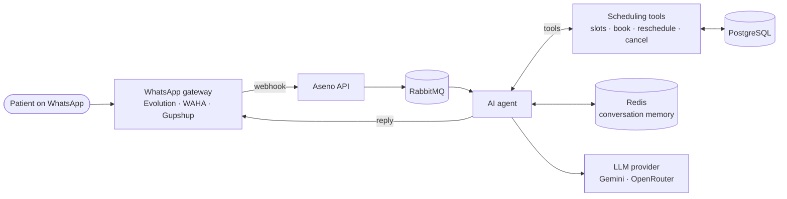

<div align="center">

# Aseno — Backend

**The API behind Aseno, a SaaS that runs health and wellness clinics end to end.**

Scheduling, patients, health records, finances and an AI agent that books appointments over WhatsApp.


</div>

---

## Overview

Aseno is used by physiotherapy, aesthetics, psychology, pilates and other clinics to manage their
day to day: the schedule, patients, payments, packages and the team. This repository is the Go API
that powers the web app ([frontend](https://github.com/aseno-up/frontend)) and is deployed on
Kubernetes ([k8s](https://github.com/aseno-up/k8s)).

The product is **multi-tenant**: every clinic has its own data, team, permissions and settings,
isolated at the query level.

## What it does

| Area | Highlights |
|------|------------|
| **Scheduling** | Individual appointments, group classes with capacity per weekday, waitlist, recurring session plans, Google Calendar sync |
| **WhatsApp AI agent** | Patients book, reschedule, cancel and confirm by chat; audio messages are transcribed; hands off to a human when needed |
| **Patients** | Records, customizable intake forms (anamnesis), attendance history and a patient portal |
| **Finance** | Cash flow, commissions per professional, sales packages, lost-revenue report, receipts |
| **Payments** | Asaas integration for charges, subscriptions and marketplace split payments, with webhooks |
| **Automation** | Appointment reminders, payment reminders, scheduled messages and timeouts run as background workers |
| **Platform** | Plans and usage limits, feature flags, audit log, AI cost tracking, onboarding by magic link |

## The WhatsApp AI agent

The agent is the core differentiator. It receives messages from WhatsApp, decides what the patient
wants and acts on the clinic's real data through function calling.



- **20+ tools** the model can call: find free slots, create or move appointments, enroll in group classes,
  look up procedures, prices and professionals, and hand the conversation to a human.
- **Provider-agnostic**: Gemini or any model via OpenRouter, with automatic fallback between models.
- **Guardrails**: per-clinic switches for each flow (scheduling, confirmation, cancellation),
  human takeover that pauses the bot, and protection against double booking.
- **Observability**: token usage and cost per conversation, plus optional tracing with Langfuse.
- **Evaluated**: prompt and tool behavior covered by tests, including evaluation scenarios.

## Architecture

Each business domain lives in its own package under `pkg/`, split into four layers:

```
handler  →  service  →  repository  →  model
 (HTTP)    (business     (GORM /       (entities)
            rules)       PostgreSQL)
```

Interfaces are public and implementations are private, so every layer can be replaced by a mock
in tests.

```
cmd/api/            entry point: wiring, routes, migrations
internal/
  config/           environment configuration
  worker/           background jobs (reminders, payments, timeouts)
  queue/            RabbitMQ producer and consumer
  redis/  crypto/   infrastructure helpers
  logger/ retry/    cross-cutting concerns
pkg/
  appointment/  booking/  sessionplan/  waitlist/     scheduling
  patient/  patientrecord/  attendance/               patients
  finance/  commission/  salespackage/  payment/      money
  whatsapp/   agent · classifier · transcriber · tools · clients
  auth/  clinic/  clinicmember/  plan/  featureflag/  platform
  ...       40+ domains in total
```

## Tech stack

| | |
|---|---|
| Language | Go 1.23 |
| HTTP | Gin |
| Database | PostgreSQL with GORM |
| Cache and conversation memory | Redis |
| Messaging | RabbitMQ |
| AI | Gemini, OpenRouter, Langfuse |
| Integrations | Asaas, Google Calendar and OAuth, Evolution API, WAHA, Gupshup, Brevo, Meta Conversions API |
| Tests | Go testing and Testify |
| Delivery | Docker image on GHCR, deployed to Kubernetes on version tags |

## Running locally

Requirements: Go 1.23+, Docker.

```bash
# 1. Start PostgreSQL, Redis and RabbitMQ
docker run -d --name aseno-postgres -p 5432:5432 \
  -e POSTGRES_USER=aseno -e POSTGRES_PASSWORD=aseno -e POSTGRES_DB=aseno_db postgres:16
docker run -d --name aseno-redis -p 6379:6379 redis:7
docker run -d --name aseno-rabbitmq -p 5672:5672 rabbitmq:3-management

# 2. Configure the environment (set DATABASE_URL, RABBITMQ_URL, JWT_SECRET)
cp .env.example .env

# 3. Run the API (http://localhost:4901)
go run ./cmd/api
```

The database schema is created and updated automatically on startup.

Useful commands:

```bash
make test            # run the test suite
make test-coverage   # tests with coverage report
make lint            # static analysis
make help            # list all commands
```

## Deployment

Pushing a tag like `v1.4.0` triggers GitHub Actions, which builds the Docker image, publishes it to
GitHub Container Registry and rolls it out to the Kubernetes cluster.

---

<div align="center">
Built by <a href="https://github.com/jhamiltonjunior">Hamilton Santos</a>
</div>
